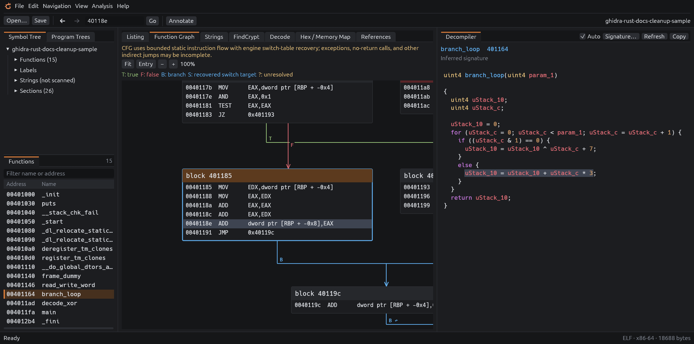

#  Ghidra Rust

Ghidra Rust is an early-alpha desktop for static binary analysis. Open a
program to browse its disassembly, control-flow graphs, and C-like pseudocode
side by side. The native app uses a Ghidra-derived decompiler and runs without
Java or Python.



## Quick start

Download the Linux x64 tarball or Windows x64 ZIP and run the desktop executable.
The archives also include a headless console tool. [GitHub Releases](https://github.com/mahirriki1/ghidra-rust/releases)

- **Linux x64** requires OpenGL, bubblewrap, and working unprivileged user
  namespaces. [Linux setup](docs/linux.md)
- **Windows x64** requires an OpenGL driver and local drives. The analysis
  worker has resource limits but can access the filesystem and network. Use
  trusted binaries. [Windows setup](docs/windows.md)

Choose **Open binary** or drop a file into the window. In **Analyze binary?**,
choose function discovery, strings, and optionally FindCrypt. You can keep
browsing while analysis runs or start it again from **Analysis → Auto analyze…**.

Open a function from the Functions list. Click an instruction or mapped
pseudocode to highlight its counterpart. Double-click a resolved call to
follow it, and use Back to return.

## What you can open

Linked executables and shared libraries need file-backed executable sections.
Analysis runs on the file without executing it.

| Input | Supported architectures |
| --- | --- |
| ELF | x86, x86-64, little-endian AArch64 with a 64-bit ABI |
| PE | x86, x86-64, Windows ARM64 PE32+ |
| Mach-O | Thin x86, x86-64, and baseline Apple Silicon arm64 |

See the architecture guide for exclusions and platform validation.
[Architecture coverage](docs/architectures.md)

## Keyboard shortcuts

| Key | Action |
| --- | --- |
| `F1` | Show all shortcuts |
| `Space` | Switch between Listing and Function Graph |
| `G` | Go to an address, exact name, or file offset |
| `X` | Show references to the selected target |
| `S` / `Ctrl+F` | Search memory / loaded program text |
| `L` / `;` | Rename / edit a comment |
| `Alt+Left` / `Alt+Right` | Go back / forward |
| `Ctrl+S` | Save a project |

The Listing starts in **Program** scope. Choose **Function** in its title row
to focus on one function. See the analysis guide for navigation, search, byte
inspection, and editing. [Desktop workflows](docs/analysis.md#desktop-workflows)

## Projects

A `.grproj` project stores annotations and selected analysis results. It
includes the binary by default. For an external-binary project, select the
matching binary when you reopen it. Reopened results show **Saved analysis**
until recomputed. Open projects only from trusted sources because SQLite
parses them in the desktop process. [Projects](docs/analysis.md#project-formats-and-saved-analysis)

## Guides

Browse the full guide set online if you are reading from a portable archive.
[Project documentation](https://github.com/mahirriki1/ghidra-rust/tree/main/docs)

| If you want to… | Read |
| --- | --- |
| Analyze without a desktop window | [Headless API](docs/headless.md) |
| Try the Linux live debugger backend from source | [Live debugger](docs/debugger.md) |
| Understand what discovery can recover | [Analysis coverage](docs/analysis.md) |
| Interpret C++, Rust, or MSVC names | [Demangled display names](docs/demangling.md) |
| Decode bytes or identify crypto constants | [Decode and FindCrypt](docs/crypto-signatures.md) |
| Check performance or compare results with Ghidra | [Analysis measurements](docs/analysis-performance.md) |
| Build, package, or update the app | [Release workflow](docs/releases.md) |

## Build from source

Use Rust 1.98.1, a native C/C++ toolchain, and an OpenGL-capable desktop.
Platform setup and local checks are in the [Linux guide](docs/linux.md) and the
[Windows guide](docs/windows.md).

```sh
cargo run --release --locked
```

See the repository guidance before contributing. [AGENTS.md](AGENTS.md)

Licensed under [Apache 2.0](LICENSE). See [NOTICE](NOTICE) for attribution.
