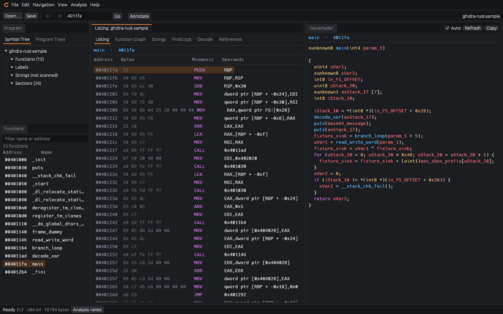
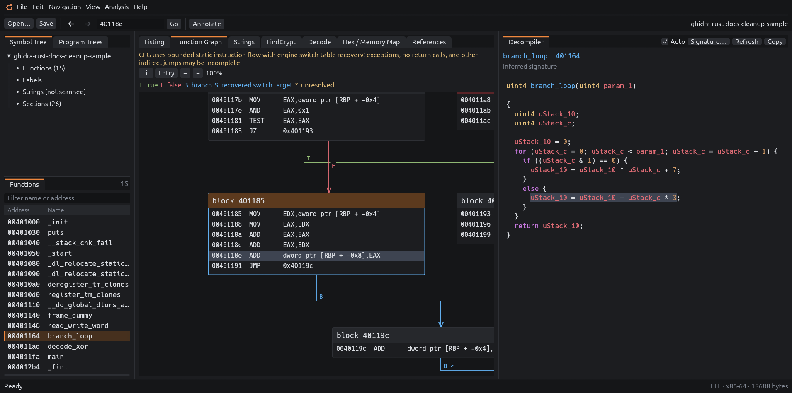

#  Ghidra Rust

An early alpha native Rust reverse engineering desktop with Ghidra-derived
decompilation and IDA-inspired function-graph navigation. The desktop runs without
Java or Python. It is an initial implementation, not a full Ghidra replacement.

## Run

Use Rust 1.98 or newer, a native C/C++ build toolchain, and an OpenGL-capable desktop.
Linux analysis requires **bubblewrap** (`bwrap`) and working unprivileged user
namespaces. The Linux sandbox setup currently targets conventional `/usr`-based
distributions. Windows x64 has an experimental native MSVC build path and
Windows-specific file identity and worker resource controls. See the
[Windows build/run guide](docs/windows.md) for the portable package, validation
script, and desktop check. macOS remains unvalidated.

```sh
cargo run --release --locked
```

Use **Open binary**, **Open project**, or drop a file into the window. You can also pass a file path
when launching the desktop executable. The initial engine build can take several
minutes. Release builds are appropriate for evaluating interactive performance.

For downloadable Linux/Windows packages and the workflow to ship every version,
see [building and shipping releases](docs/releases.md). Each push/merge to `main`
automatically reserves the next patch version, builds and lints both platforms,
then publishes a GitHub Release with detailed change bullets, executables,
complete archives, and checksums. Tests run locally before merging. Version tags
can also build packages manually.
[Linux runtime requirements](docs/linux.md) include compatible glibc,
desktop graphics, and bubblewrap; Linux downloads are not universal static builds.

### Native Windows

For a prebuilt download, double-click `ghidra-rust-VERSION-windows-x64.exe` from a
local Windows folder to open the GUI directly. No build tools are required to run
it. The ZIP bundle includes documentation and the accompanying license notices.
See the [Windows guide](docs/windows.md#run-the-prebuilt-exe).

Install Rust and Visual Studio Build Tools with **Desktop development with C++**
(including an x64 MSVC toolchain and Windows SDK), as described in
[Microsoft's Rust setup guide](https://learn.microsoft.com/en-us/windows/dev-environment/rust/setup).
From PowerShell in this repository on Windows:

```powershell
rustup toolchain install 1.98.1-x86_64-pc-windows-msvc --component rustfmt,clippy
cargo +1.98.1-x86_64-pc-windows-msvc build --release --locked --target x86_64-pc-windows-msvc
.\target\x86_64-pc-windows-msvc\release\ghidra-rust.exe
```

The built desktop is `target\x86_64-pc-windows-msvc\release\ghidra-rust.exe`. It uses native Windows
OpenGL and does not need WSL, bubblewrap, Java, or Python. Build it from a Windows
checkout rather than copying the Linux executable. SQLite is bundled into the
build, and the MSVC runtime is linked statically; a separate SQLite or MSVC runtime
installation is unnecessary. Local disk files are
supported; device paths, alternate streams, UNC paths, and mapped network drives
are rejected. File systems must support the Windows file-ID APIs.

For the full Windows checks and a ZIP with licenses, run:

```powershell
rustup run 1.98.1-x86_64-pc-windows-msvc powershell -NoProfile -ExecutionPolicy Bypass -File .\scripts\build-windows.ps1
```

The standalone EXE, ZIP, and SHA-256 checksums are written under `target\dist`. Extract the ZIP and
double-click `ghidra-rust.exe`. Run it before pushing: the Windows CI job uses
this same script with `-SkipTests`, so it builds and packages without running
tests, and retains the package as a workflow artifact. See
[Windows instructions and troubleshooting](docs/windows.md) for details.

Windows worker limits are resource controls, **not a security sandbox**. Use this
experimental Windows build with trusted inputs. It has no filesystem or network
isolation equivalent to the Linux worker.

The workspace follows Ghidra's familiar layout: Symbol/Program Trees and Functions
on the left, the Listing or Function Graph in the middle, and the Decompiler on
the right. Long instruction rows stay on one line with horizontal scrolling.
Annotation editing opens in a separate tool window. File selection is built into
the app and does not require a desktop file-dialog portal.
On Windows, window controls share the menu row: drag its empty space to move the
window, double-click it to maximize/restore, or drag an edge to resize.

The rust-orange dragon is the current project logo, shared by the native window
icon, README, and a small mark immediately before **File** in the menu bar. The
vector source is [ghidra-rust-logo.svg](docs/images/ghidra-rust-logo.svg); regenerate
the transparent PNG used by the native app with:

```sh
rsvg-convert --width 256 --height 256 docs/images/ghidra-rust-logo.svg -o docs/images/ghidra-rust-icon.png
```

The window icon is separate from Windows executable-file icon resources.

The default Carbon appearance keeps Ghidra's classic layout in a dense,
near-black style: editor-style pane tabs, underlined view switchers, soft
borderless controls, and the dragon's orange as the selection and focus accent.
Listing columns and graph blocks are colored, with slightly rounded blocks.
Decompiled code uses a One Dark-style palette for keywords, types, function
names, comments, constants/strings, and identifiers. Highlighting is lexical; semantic
roles such as parameters versus globals require richer engine token information.
Text is tokenized when a new result arrives and visible lines are drawn from cached
spans. The cache is capped at 65,536 spans; unusually dense results fall back to
plain text while retaining the complete pseudocode for copying.



## Keyboard and navigation

- **L:** rename the selected function entry or set an address label. The existing
  name is selected; **Enter** applies and **Escape** cancels. Labels and function
  renames are saved in projects or exported JSON annotations. Select a supported
  decompiler local token and press **L**, or right-click it, to rename that variable.
- **G:** go to a hexadecimal address or an exact known function/label name.
- **;:** open the comment editor at the selected address.
- **Space:** switch Listing / Function Graph.
- **Alt+Left / Alt+Right:** history, also available through the top arrow buttons.
- **Ctrl+S / Ctrl+Z:** save project / undo an annotation outside text editors
  (Command on macOS).

Shortcuts do not fire while typing, using a dialog, or waiting for file operations.
Double-click a resolved call instruction in the listing or graph to navigate to
its target. In the decompiler, double-click a function-name token emitted for a
resolved direct call to navigate to the engine's actual target, even after a
callee rename or when names collide. Strings, comments, indirect/unresolved
calls, and legacy caches without semantic tokens do not trigger jumps. Refresh
legacy pseudocode to obtain semantic navigation.

Selecting an instruction in the Listing or Function Graph highlights the
corresponding pseudocode statement/expression. Clicking a mapped pseudocode
statement selects its associated instructions, scrolls the listing, and reveals
the selected CFG block. These links come from the engine's p-code print marks,
not line-number or text matching, and are saved in projects. One expression may
correspond to several instructions. Instructions removed during optimization,
unmapped declarations, and results outside the bounded graph can have no visible
counterpart; the app does not invent one. Double-clicking a known call still
navigates to that function.

Address comments appear beside instructions in the Listing and on their own rows
in the Function Graph. The Decompiler shows each comment once above a genuinely
mapped statement; function-entry comments appear at the top. Comments for
instructions without visible pseudocode remain under **Comments without visible
code**. Long comments use single-line previews: double-click a decompiler comment,
use an instruction's context menu, or press **;** to read and edit the full text.
**Annotate** (also **View → Annotations**) opens a filterable browser of addresses,
labels, and comments. Click an address to jump, or **Edit** to open its comment;
Back/Forward returns to the exact instruction. A known function context is retained
when the address has been observed in its graph or decompiled code. Data annotations
open the bytes in Decode rather than treating their addresses as functions.



The README screenshots are captured from the native desktop built with
`--features capture`; `src/capture.rs` documents the environment variables that
open a function, select an instruction, and write one frame.

Local renaming supports genuine recovered symbols with a single whole stack or
register storage mapping (including recovered parameters). The engine renames
the symbol before printing, so declarations and all uses change together and
instruction mappings retain correct byte offsets. Names must be C identifiers
of 1–64 ASCII bytes; keywords and collisions with another local are rejected.
Globals, split/merged-conflict symbols, dynamic/unique-only temporaries, fields,
objects larger than 256 bytes, and tokens without a verified identity are
unsupported. Identity collection also has bounded symbol and definition/use budgets. Such tokens display a
clear unsupported status and cannot silently rename an address label.

Overrides are bound to the binary, function, pinned engine, storage/use limits,
type and recovered definition/use structure. Revisit, worker restart, project
reopen and JSON import replay only the current function's bounded overrides.
Absent, ambiguous, changed or incompatible identities remain saved and visibly
**not applied**; refresh cannot redirect them to a different variable. Ctrl+Z
undoes local renames alongside other annotations. At most 64 overrides per
function and 4,096 per session are supported. JSON v1 annotations remain readable;
annotations containing local names use v2 so older clients reject them. Engine
cache mismatches retain overrides for inspection, but incompatible identities
are never applied automatically.

## Current workflow

- Open linked x86/x86-64 or little-endian AArch64 ELF, PE, or Mach-O images with
  file-backed mapped sections. AArch64 uses the container's 64-bit ABI, including
  Windows ARM64 and baseline Apple Silicon arm64. ARM/Thumb, arm64e, ARM64EC,
  ILP32, big-endian images, other processors, raw images, archives, relocatable
  objects, universal/fat Mach-O, and sectionless images are rejected.
  See [architecture coverage and limits](docs/architectures.md).
- Browse/filter known functions; start at `main` when found, otherwise the entry
  point. PE exports and supported x64/ARM64 exception-table function entries load
  on open, including stripped images. In stripped dynamically linked x86-64 ELF
  executables, `main` is recovered from glibc's startup call to
  `__libc_start_main` and labeled as analysis-derived in **Analysis notes**
  ([details](docs/analysis.md#stripped-elf-startup)). The list is capped at 262,144 entries and
  8 MiB of names; large PEs prioritize the entry point, exports, and runtime
  functions near entry, with a visible partial-list notice. Projects containing
  more than 10,000 functions cannot be opened by releases before this limit.
  **Discover functions** follows confirmed decoded direct calls from known entries
  on every supported architecture in resumable bounded batches. Discover starts or
  continues a parent-owned session queue containing the entry point and all
  admitted known functions, then newly confirmed callees. Complete function
  recovery is not guaranteed; see [analysis coverage](docs/analysis.md).
- Opening a binary offers to analyze it, like Ghidra: an **Analyze binary?**
  dialog runs the checked analyses (function discovery, defined strings,
  FindCrypt) in the background while you browse. **Analysis → Auto analyze…**
  reopens it; see [auto analysis](docs/analysis.md#auto-analysis).
- Navigate a function's instruction CFG with pan, zoom, branch labels, and
  unresolved-flow markers. CFG recovery is bounded; switch jump tables are
  resolved through the engine's flow analysis (`S` edges), and warnings identify
  unsupported or incomplete cases such as other indirect flow. Calls are
  displayed separately from intra-function branches. Recognized named no-return
  calls (such as `exit`/`abort`) end their block and show a **[no return]** marker;
  custom wrapper inference remains unsupported. See [no-return coverage](docs/analysis.md#no-return-calls).
  Large graphs open around the entry block at a readable scale. **Fit** shows the
  complete overview with text hidden at small scales; **Entry** returns to readable
  entry code. Nonlocal and loop edges use separate routes outside the block columns.
- Switch between the graph and listing. Read separately requested C-like
  decompilation, inspect outgoing direct calls, and navigate by address. After
  discovery, the **References** tab shows incoming and outgoing confirmed calls
  for the current function, with navigation to callers, callees, and call sites.
  **Data accesses** shows direct reads and writes, including x86 memory
  operands, ARM64 literal loads, and ARM64 `ADRP`/`ADD`-style addresses built
  from register constants within one basic block (labeled *propagated*). Open a
  source instruction or load the accessed bytes into Decode; filter by an exact
  target address to find its accesses. Other register addresses, loaded
  pointers, and values carried across branches or calls are unresolved. Coverage
  is limited to the functions examined in committed discovery batches in this
  session.
- Scan mapped bytes for ASCII and a printable ASCII subset of UTF-16LE strings.
  The tree shows **not scanned** until a scan runs. This is not complete Unicode
  or Rust string-slice recovery. **Analysis notes** shows loading and coverage limits.
  The Strings tab defaults to six characters and accepts a minimum from 4 to 64.
  This minimum applies before the 10,000-result cap; the text filter searches only
  loaded results. Increase the minimum and rescan when short-string noise fills the
  result budget. A partial scan is explicitly marked; the 64 MiB scan budget remains.
- Open **Hex / Memory Map** from the middle tabs or **View**, or click a section
  in the Program Tree. The virtualized map shows loaded mapped sections with
  exclusive virtual/file ranges, mapped and file-backed sizes, and executable
  status. Browse section-relative 4 KiB pages with **Prev/Next** or the local
  **VA (hex)** field. Unmapped addresses show an error without replacing the page.
  File-backed bytes show their file offset on hover; muted zero-filled bytes
  have no file offset. This is the analyzed snapshot, not runtime process memory
  or a whole-file view: unmapped headers and overlays are outside its scope.
  Click and Shift-click bytes in hex or ASCII to select within the loaded page,
  then **Decode selection** copies exactly that slice and its starting address.
  Selection clears when changing pages. Browsing preserves function navigation
  and annotations; pages and selection are transient and are not saved in projects.
  Reads wait for busy analysis and rapid paging retains only the newest queued
  read. A canceled or failed page requires **Retry**.
- Use **Decode** for selected memory or pasted text/hex: UTF-8, UTF-16LE/BE,
  standard padded Base64, hex, or XOR. XOR keys use explicit `hex:` or `text:`
  prefixes. Common-decoding suggestions are heuristics and require analyst review.
- Use **FindCrypt** for a small independent set of standardized crypto constants.
  Results are navigable candidates, with algorithm-family ambiguities preserved.
  See [signature coverage and provenance](docs/crypto-signatures.md). This is not
  parity with every FindCrypt database and does not recover encryption keys.
- Save a `.grproj` project, or export/import the existing versioned JSON annotation
  sidecars. Both are bound to the binary's SHA-256. The app does not patch binaries
  or write Ghidra/IDA project databases.

Conventional UPX-packed PE files, including the standard Rufus 4.15 executable,
contain an unpacker stub and compressed application code. The loader shows a
packed-image notice and disables decompilation/function discovery for detected
images because analyzing the stub can exhaust the worker's memory budget.
Listing, CFG, string scans, and byte inspection remain available, but compressed
bytes do not reveal the original functions or strings. Unpack a separate copy
with UPX, for example `upx -d -o unpacked.exe original.exe`, then open that copy.
The desktop does not unpack or execute the input. Detection covers the conventional
UPX PE layout, not every packer or modified stub.

## Project files

**File → Save project** or **Ctrl+S** creates a single SQLite `.grproj` file.
It stores function names, local-variable name overrides, comments, decoded annotations, the known function list,
the current function's graph/listing and pseudocode, string/crypto scan results,
committed discovery results (per-function status, call and data references, and
counters), and the selected address. It is a snapshot of these results; it does
not serialize the upstream decompiler's complete internal database or all
previously visited functions. The engine reopens the binary before accepting saved
results. Reopened references are labeled **Saved analysis**; **Discover** replaces
them with a fresh run instead of resuming from saved statuses. Saved function
lists retain their saved-result provenance until recomputed. Projects are written
as version 3; earlier releases reject them, while version 1 and 2 projects still open.
The semantic-token upgrade refreshes older analysis caches while retaining their
annotations and embedded binary; rerun discovery to rebuild saved references.
Graph exits and call targets outside every mapped section, such as a fallthrough
past the end of `.text` after a no-return call, are saved as unresolved.

**File → Include binary in project** is enabled initially. Keeping it checked
embeds the exact analyzed binary, so the project can move between Linux and
Windows without the original file. Uncheck it for a smaller file; opening that
project explicitly asks you to locate the binary and verifies its SHA-256.
Stored source paths are display hints and are never opened automatically.
**Save project as** creates another copy. Saved graph/pseudocode is marked
**Saved analysis**; **Analysis → Refresh function** recomputes it. A changed
engine fingerprint discards cached results and retains compatible annotations.

Saving builds and syncs a new database beside the destination, then replaces the
destination atomically. A complete project needs no `.rep`, WAL, or other database
companion directory. Original input identities and matching binary destinations
are protected from overwrite. **Export annotations (JSON)** keeps the earlier
sidecar workflow available; exporting JSON does not mark an existing project saved.
There is no autosave or Ghidra `.gpr`/`.rep` or IDA `.i64` import compatibility.

Projects are untrusted persisted data, not authenticated analysis. A matching
binary hash does not prove that saved pseudocode or comments are accurate. The
loader checks versions, schema, mappings, collection bounds, and binary identity,
but SQLite currently parses the private project snapshot in a GUI background
thread rather than a sandboxed process. Use projects from trusted sources.

C++ and Rust binaries use the supported machine-code analysis path. Available
symbol demangling comes from the upstream engine; MSVC demangling, sophisticated
class/trait recovery, and reconstruction of original source are not provided.
Decompiler location links refer to machine instructions in the current function;
they do not provide source-level variable/type editing or recovery of the
original source language.

## Responsiveness and boundaries

Engine work runs in a disposable subprocess. Navigating while analysis is busy,
canceling, a transport failure, or a 30-second wall-time limit stops that worker.
The next action can reopen it. UI results are bound to the current request,
selection, and annotation state. Dialogs, session I/O, and decoding jobs run in
background threads. Lists draw visible rows and graph geometry is cached.
Analysis jobs lasting over 200 ms show a compact animated bar at the bottom right,
with the active task and elapsed time. It indicates activity without estimating
a completion percentage. **Analysis → Cancel analysis** stops the worker.
Function discovery reports cumulative examined/remaining function counts, committed
batches, and partial or complete seed coverage. Each batch also reports Seeds,
Calls, and Publish stages with decode-attempt counts. Its total can grow as calls
reveal more work. Interactive requests take priority between batches. Cancel keeps
committed references and the remaining queue; Discover resumes after reopening
the disposable worker and replaying function context through bounded requests.
Interrupted seeds retry individually at most once, then remain failed. Progress
updates do not extend the worker deadline.

Linux workers run under bubblewrap with private namespaces, no network, read-only
`/usr`, a read-only executable, and only the selected input file exposed from the
user's data. The analysis image is immutable for the session. Linux workers also
have a 2 GiB address-space cap, no core dumps, no privilege escalation, and a
per-request CPU soft budget of about 20 seconds. These controls reduce exposure;
they do not establish that this application or its upstream engine is free of
vulnerabilities. Windows workers start suspended, join a kill-on-close job with
a 2 GiB process-memory limit and one-process limit, then resume; they also have a
per-request CPU watchdog. Windows jobs do not isolate filesystem/network access.
Other non-Linux process sandboxing has not been implemented.

Prototype resource limits include 128 MiB input files, 2,048 recovered instructions
and 128 blocks per graph, 64 KiB byte selections, a 262,144-entry function inventory, bounded result lists,
64 MiB scanned data, 2 MiB decompiler text, 32,768 semantic ranges with at most
64 instruction addresses each and 131,072 total address references, 8 MiB annotation
sidecars, and 224 MiB projects. Project and worker-reply collections are capped
while parsing, worker replies are shape-checked and must answer a sent request
before they are decoded, and saved addresses are checked with indexed section
lookups. These bound the cost of hostile files and replies; they do not isolate
project parsing. The
snapshot currently duplicates image bytes retained by the engine; total memory
must be measured before making efficiency claims.
An opt-in [analysis measurement harness](docs/analysis-performance.md) records
client/worker timings and process-tree memory; its scope excludes the native GUI.
A separate opt-in [differential benchmark](docs/analysis-performance.md#differential-comparison-with-ghidra)
runs a separately installed Ghidra and the contained worker on identical original
corpus builds, reporting function/call recovery, decompilation outcomes, pseudocode
text similarity, wall time and process-tree memory for both.
Each discovery batch examines at most 128 function entries and charges at most
16,384 decode attempts, with a 2,048-attempt limit per function. There is no
128-function cumulative ceiling: batches continue across the admitted inventory.
Function-start scanning separately accepts at most 256 cursor-processing replies,
including 64 uncharged match-point resumes, and bounds cumulative full-inventory
validation work; exhausting those parent-owned allowances marks coverage partial.
Call and data reference aggregates are each capped at 16,384 unique entries;
reaching a cap visibly marks coverage partial. A limited or failed function walk
is terminal for this session. Projects save committed results for display only;
a reopened project's Discover starts a fresh queue. Failed decodes and work
omitted by display limits count against these budgets. On x86-64 ELF and PE, once
the queue drains, discovery scans for Ghidra's function-start byte patterns and
admits only candidates whose complete code decodes outside existing functions;
see [function-start patterns](docs/analysis.md#function-start-patterns).

Function-list and decompiler-text limits bound returned results, after the engine
has constructed its internal data. They are not preallocation limits inside the
upstream engine. Linux address-space/CPU limits, Windows job/watchdog limits, and the GUI deadline contain
resource failures in that worker. Stable original-file identity is also retained
outside the worker so renaming/replacing the input pathname cannot defeat session
write protection. Platforms without the implemented identity support fail closed.

If the local Wayland/Mesa setup cannot initialize OpenGL, this X11 software-rendering
configuration is useful for troubleshooting:

```sh
env -u WAYLAND_DISPLAY LIBGL_ALWAYS_SOFTWARE=1 cargo run --release --locked
```

Software rendering is a compatibility option, not a performance optimization.

## Development and validation

```sh
cargo fmt --all --check
cargo test --locked
cargo clippy --all-targets --locked -- -D warnings
cargo build --release --locked
```

Linux process integration tests compile the small original C fixture using GCC
and compare confirmed direct calls with GNU objdump from binutils.
Unit tests cover architecture/ABI selection, real x86 CFG behavior,
malformed/bounded requests, immutable image reads, decoding, signature detection,
session identity/write protection, and GUI components rendered without a display.
The original AArch64 fixture exercises contained ELF/PE/Mach-O workers and embedded
project round trips without a cross compiler or emulator.

The pinned analysis dependency is
[`koute/ghidra-decompiler`](https://github.com/koute/ghidra-decompiler/tree/268c3a406d8d964bc00ae2ead4d3e1e1373aaa27)
at commit `268c3a406d8d964bc00ae2ead4d3e1e1373aaa27`. It supplies the engine and
embedded language data; a separate Ghidra source checkout is unnecessary for
building or running this desktop.

The Linux prototype passed unit/UI tests, real worker-process integration,
production bubblewrap worker/project integration, formatting, strict Clippy, and
an optimized build. Native GUI checks exercised
the three-pane layout, graph/decompiler navigation, string decoding, crypto scanning,
manual file-path entry, and saving/reopening annotations and an embedded project.
Native Windows x64 validation with Rust 1.98.1 and MSVC compiled bundled SQLite,
linked debug and release executables, and passed unit/UI tests plus the real
PE worker/project integration test in both debug and release. One ignored unit
test is a subprocess fixture exercised by the job-lifecycle test. The release
OpenGL GUI was launched on Windows and used to save and reopen an embedded
project with saved listing/pseudocode. The EXE imports Windows system DLLs without
MSVC-runtime or SQLite DLL dependencies. These are local results; GitHub Actions
only builds and packages each commit without running tests. The Windows build
script is shared with CI.

PE loading supplies export names, supported x64/ARM64 runtime-function starts,
and named import slots to the decompiler. Ordinary x86 import jump thunks reached by confirmed calls
are named during bounded function analysis. ARM64 PE recovers primary entries
from packed and supported full unwind records, and names exact ADRP/LDR/BR import
veneers at established entries or confirmed call targets. Fragment records do
not independently establish functions; parent links and unsupported unwind forms
remain explicit omissions. See [analysis coverage](docs/analysis.md). PDB types,
imported API prototypes, library signature matching, delay imports, and Windows
Control Flow Guard substitutions remain incomplete. Known hexadecimal addresses remain navigable.
The PE integration tests check named exports and recovery after exports are removed.

The architecture/ABI, confirmed-call, ARM64 PE and semantic-token fingerprints invalidate
older saved graph/decompiler caches when a project reopens; compatible annotations are
retained. Project v3 and JSON v2 preserve local renames; older formats remain readable.
When comparing
against a Ghidra project, compare the recorded executable SHA-256 and the selected
function address. An installed program can change at the same path after an update.

The Windows sandbox and project-parser trust limitations above remain explicit;
the application has not had a comprehensive security or dependency audit. One stalled directory read
can still remain blocked, but repeated cancellations cannot accumulate reader threads.
Final publication is not relative to retained directory handles; same-user parent
directory substitutions and Windows delete-sharing renames remain residual races.
Existing Java plugins, a general plugin SDK, Python scripting, a user-facing CLI,
debugger integration, type editing, arbitrary variable-storage editing, automatic custom decryption, and
Ghidra project import are later work. Performance improvements over Ghidra have
not yet been measured.
